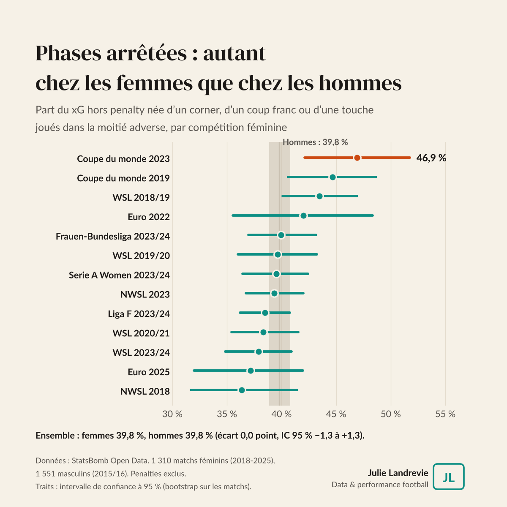
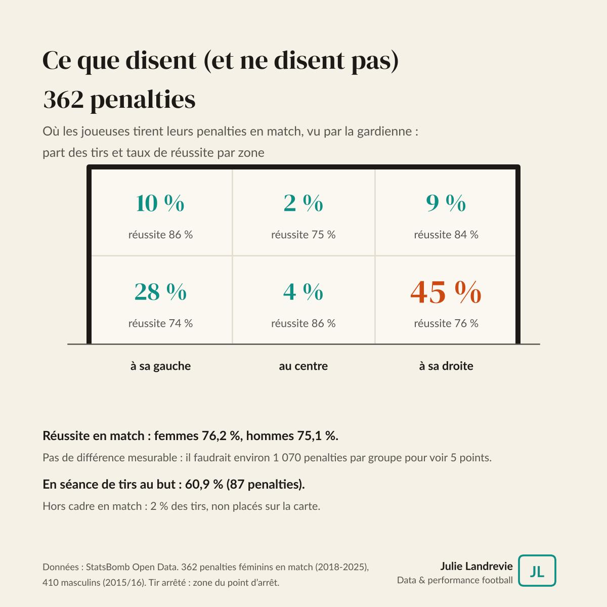

# Études courtes en football féminin

Une question, des données ouvertes, une réponse chiffrée avec son intervalle de confiance, des limites, et le résultat publié même s'il est nul.

Données : **StatsBomb Open Data** (https://github.com/statsbomb/open-data), sous les conditions de la licence StatsBomb.

```bash
pip install pandas numpy pytest
python scripts/etude2_cpa.py           # télécharge les événements (cache dans donnees/) et calcule
python scripts/etude2_differences.py   # écarts entre groupes, IC 95 %
python scripts/etude3_penalties.py     # étude 3 (lit les tirs extraits par l'étude 2)
python -m pytest -q tests
```

---

## Étude 2 — Quelle part des occasions vient des phases arrêtées ?

**Question.** Quelle part du xG hors penalty naît des corners, coups francs et touches dans les compétitions féminines, et est-ce plus ou moins qu'en football masculin ?

**Données.** Toutes les compétitions féminines de StatsBomb Open Data : FA WSL 2018/19, 2019/20, 2020/21 et 2023/24 ; Frauen-Bundesliga, Liga F et Serie A Women 2023/24 ; NWSL 2018 et 2023 ; Euros 2022 et 2025 ; Coupes du monde 2019 et 2023. Au total, 1 310 matchs et 33 924 tirs. Comparaison masculine : Premier League, Liga, Serie A et Ligue 1 2015/16, plus la Bundesliga 2015/16 (34 matchs seulement dans les données ouvertes), soit 1 551 matchs et 38 318 tirs.

**Définitions, posées avant de regarder les résultats.**
- Exclus : penalties et séances de tirs au but.
- Un tir vient d'une phase arrêtée si sa possession a commencé par un corner, un coup franc ou une touche (`play_pattern`).
- **Définition retenue, « moitié adverse »** : la remise en jeu qui ouvre la possession est jouée dans la moitié adverse (x ≥ 60 sur 120). C'est ce qu'un staff appelle une phase arrêtée offensive.
- Variantes, pour mesurer la sensibilité à la définition : définition large (toute remise en jeu, partout), sans les touches, et fenêtre stricte (le tir est l'une des 3 premières actions avec ballon de la possession).
- Intervalles de confiance à 95 % : bootstrap sur les matchs (1 000 tirages par compétition, 2 000 pour les écarts), parce que les tirs d'un même match ne sont pas indépendants.



**Résultats.**

| Définition | Femmes | Hommes | Écart femmes − hommes (IC 95 %) |
|---|---|---|---|
| **Moitié adverse** | **39,8 %** | **39,8 %** | **0,0 point [−1,3 ; +1,3]** |
| Fenêtre stricte (3 actions) | 17,3 % | 17,8 % | −0,6 [−1,5 ; +0,3] |
| Sans les touches | 31,1 % | 34,5 % | −3,4 [−4,7 ; −2,1] |
| Large | 50,0 % | 51,5 % | −1,5 [−2,9 ; −0,1] |

1. **Pas de différence entre femmes et hommes** avec la définition retenue : 39,8 % de part et d'autre, écart de 0,0 point [−1,3 ; +1,3].
2. **La définition pèse bien plus que le genre** : de 17 % à 50 % selon la définition, alors que l'écart entre femmes et hommes ne dépasse jamais 3,4 points. Tout chiffre de « part des phases arrêtées » doit donc donner sa définition.
3. **Les tournois féminins dépendent davantage des phases arrêtées que les championnats** : +4,2 points [+1,6 ; +7,0] avec la définition retenue (43,4 % contre 39,2 %), et le même sens avec les autres définitions. Coupe du monde 2023 : 46,9 % [42,1 ; 51,8].
4. **La répartition diffère un peu.** Chez les femmes, il y a un peu plus de corners (17,1 % du xG contre 15,7 %) et de touches (13,6 % contre 11,9 %), et moins de coups francs (9,0 % contre 12,2 %). Les coups francs directs pèsent 12,5 % du xG des coups francs, contre 16,7 % chez les hommes.

**Par compétition (moitié adverse).**

| Compétition | Matchs | Tirs | Part du xG (IC 95 %) | Fenêtre stricte | Large | Part des buts |
|---|---|---|---|---|---|---|
| FA WSL 2018/19 | 107 | 2 792 | 43,5 % [40,1 ; 46,9] | 19,0 % | 53,7 % | 38,0 % |
| FA WSL 2019/20 | 87 | 2 201 | 39,6 % [36,0 ; 43,2] | 15,6 % | 50,4 % | 36,7 % |
| FA WSL 2020/21 | 131 | 3 212 | 38,3 % [35,4 ; 41,5] | 16,4 % | 48,0 % | 40,1 % |
| FA WSL 2023/24 | 132 | 3 506 | 37,9 % [34,8 ; 40,9] | 16,2 % | 48,1 % | 37,6 % |
| Frauen-Bundesliga 2023/24 | 132 | 3 266 | 40,0 % [37,0 ; 43,2] | 19,3 % | 51,5 % | 42,1 % |
| Liga F 2023/24 | 240 | 6 114 | 38,5 % [36,2 ; 40,7] | 15,4 % | 49,2 % | 37,1 % |
| Serie A Women 2023/24 | 130 | 3 687 | 39,5 % [36,4 ; 42,4] | 19,1 % | 49,7 % | 36,9 % |
| NWSL 2018 | 36 | 1 034 | 36,4 % [31,7 ; 41,4] | 16,5 % | 44,5 % | 35,1 % |
| NWSL 2023 | 137 | 3 490 | 39,3 % [36,7 ; 42,0] | 15,5 % | 49,0 % | 36,1 % |
| Euro 2022 | 31 | 871 | 42,0 % [35,5 ; 48,3] | 21,6 % | 51,5 % | 47,0 % |
| Euro 2025 | 31 | 862 | 37,2 % [32,0 ; 41,9] | 15,2 % | 48,8 % | 33,7 % |
| Coupe du monde 2019 | 52 | 1 281 | 44,7 % [40,6 ; 48,7] | 20,9 % | 54,3 % | 42,5 % |
| Coupe du monde 2023 | 64 | 1 608 | 46,9 % [42,1 ; 51,8] | 20,3 % | 54,7 % | 40,4 % |
| Premier League 2015/16 | 380 | 9 817 | 41,4 % [39,4 ; 43,2] | 18,1 % | 51,6 % | 41,5 % |
| Liga 2015/16 | 380 | 9 071 | 38,5 % [36,7 ; 40,4] | 16,7 % | 50,4 % | 37,4 % |
| Serie A 2015/16 | 380 | 9 877 | 39,8 % [38,0 ; 41,6] | 16,9 % | 51,8 % | 40,6 % |
| Ligue 1 2015/16 | 377 | 8 723 | 39,5 % [37,3 ; 41,5] | 19,6 % | 52,1 % | 37,1 % |
| Bundesliga 2015/16 | 34 | 830 | 39,9 % [34,4 ; 45,4] | 18,6 % | 51,4 % | 36,6 % |

Fichiers : `resultats/etude2_par_competition.csv`, `resultats/etude2_differences.csv`, `resultats/etude2_detail_moitie_adverse.csv`, tirs bruts dans `resultats/etude2_tirs.csv.gz`.

**Limites.**
- `play_pattern` décrit le début de la possession : une possession lancée par un corner peut durer longtemps. La fenêtre stricte borne ce biais, d'où l'écart entre les définitions.
- La comparaison masculine porte sur 2015/16, les compétitions féminines sur 2018-2025 : le football a pu changer entre-temps.
- Tournois et championnats ne se comparent qu'avec prudence : peu de matchs par tournoi et niveaux d'opposition très variables.
- Les données ouvertes ne couvrent pas toujours toutes les rencontres d'une saison (Bundesliga 2015/16 : 34 matchs).
- Les chiffres publiés ailleurs (par exemple environ 23 % sur 12 championnats) reposent sur d'autres définitions : ils ne se comparent pas directement à ceux-ci.

---

## Étude 3 — Les penalties : où, de quel pied, avec quelle réussite ?



**Question.** Où les joueuses tirent-elles leurs penalties, de quel pied, et la réussite change-t-elle selon la zone ? Est-ce différent chez les hommes ?

**Données.** Mêmes compétitions que l'étude 2 : 362 penalties féminins en match et 87 en séance de tirs au but (Coupes du monde et Euros), 410 penalties masculins en match (championnats 2015/16, sans séance).

**Méthode.** Zone d'arrivée (`end_location`) : trois tiers du but en largeur, deux moitiés en hauteur, hors cadre à part. Les zones sont vues **par la gardienne** : sa droite correspond à la gauche de la tireuse. Côté naturel : la gauche de la tireuse pour une droitière, sa droite pour une gauchère. Réussite = but. Intervalles de Wilson pour les taux, de Newcombe pour les écarts. Calcul de puissance : nombre de penalties nécessaire pour détecter un écart de 5 points (test bilatéral à 5 %, puissance 80 %).

**Résultats.**
1. **Même réussite en match chez les femmes et les hommes** : 76,2 % [71,6 ; 80,3] contre 75,1 % [70,7 ; 79,1], soit un écart de +1,1 point [−5,0 ; +7,1]. **Résultat nul, et c'était attendu** : pour détecter un écart de 5 points, il faudrait environ 1 070 penalties par groupe.
2. **La réussite chute en séance de tirs au but** : 60,9 % [50,4 ; 70,5] sur 87 penalties, soit −15,3 points [−26,6 ; −4,7] par rapport au match. Il y a aussi plus de tirs hors cadre (6,9 % contre 1,9 %).
3. **Les joueuses tirent bas (79 %) et rarement au centre (6 %, contre 12 % chez les hommes).** La zone la plus visée est en bas, à droite de la gardienne (45 %).
4. **Aucun écart démontré selon la zone ou le pied.** Les tirs hauts réussissent un peu plus souvent chez les femmes (+10,4 points [−0,4 ; +18,8], 77 tirs hauts), mais sans certitude. Viser le côté naturel ou le côté opposé ne change rien (+2,0 points [−6,9 ; +11,4]).

Fichiers : `resultats/etude3_reussite.csv`, `etude3_zones.csv`, `etude3_cote_pied.csv`, `etude3_comparaisons.csv`.

**Limites.**
- Petit échantillon : la plupart des comparaisons ne peuvent pas trancher, et c'est le résultat lui-même.
- Pour un tir arrêté, StatsBomb note l'endroit où la gardienne touche le ballon, pas la zone visée.
- Les séances de tirs au but ne viennent que de tournois (Coupes du monde, Euros), les penalties en match surtout de championnats : la pression, mais aussi les tireuses, diffèrent.
- Aucune information sur le placement ni sur le plongeon de la gardienne.
- Comparaison masculine sur 2015/16 seulement.
